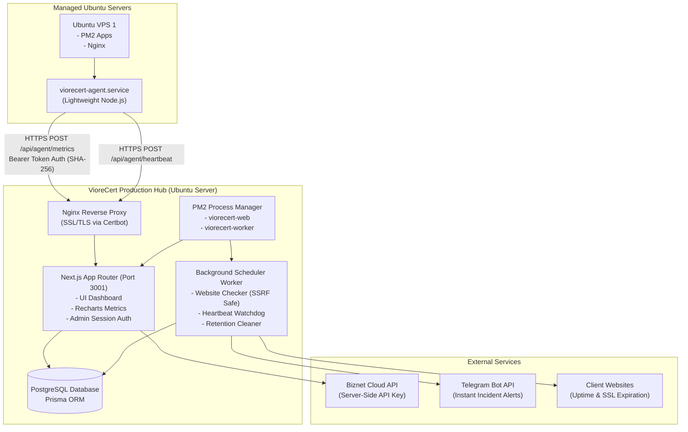
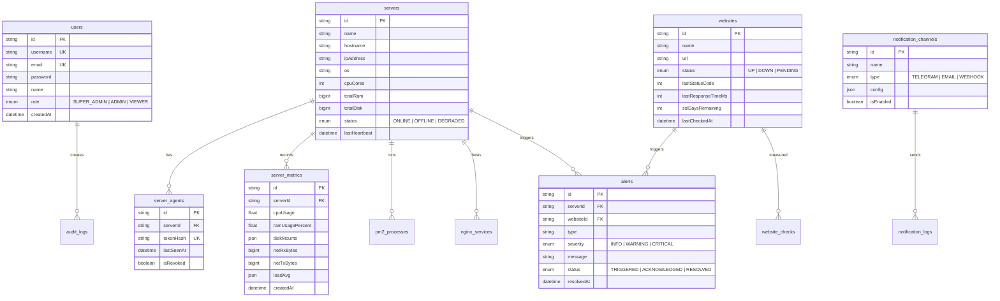

# VIORECERT SERVER MONITORING ARCHITECTURE

## 1. System Architecture Diagram

---

## 2. Entity Relationship Diagram (ERD)

---

## 3. Security & Ingestion Architecture

1. **Machine-to-Machine Authentication:**
   - When a server is added via Dashboard, a high-entropy registration token `vcert_ag_<hex>` is issued once.
   - The database stores strictly `SHA-256(token)`. Plaintext tokens are never stored.
   - Every agent payload includes `Authorization: Bearer vcert_ag_...`.
   - The API verifies hashes in constant time to prevent timing attacks.

2. **SSRF Mitigation:**
   - Any website added for monitoring undergoes DNS and IP range validation.
   - Private IP blocks (`127.0.0.1`, `localhost`, `10.0.0.0/8`, `172.16.0.0/12`, `192.168.0.0/16`, `169.254.169.254`) and non-HTTP protocols (`file://`, `ftp://`, `gopher://`) are strictly blocked.

3. **Biznet Cloud Isolation:**
   - Biznet credentials (`BIZNET_API_KEY`) reside exclusively in server-side environment variables.
   - Keys are never reflected back in API responses, browser local storage, or audit logs.

4. **Alert Cooldown & Deduplication:**
   - Alerts of the same type for a given server or website are subject to a 15-minute cooldown window to prevent notification floods.
   - Resolved alerts generate clear audit trails.
